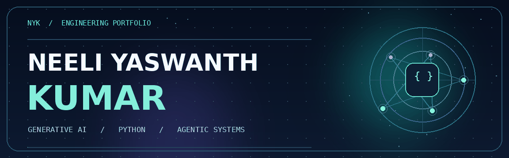
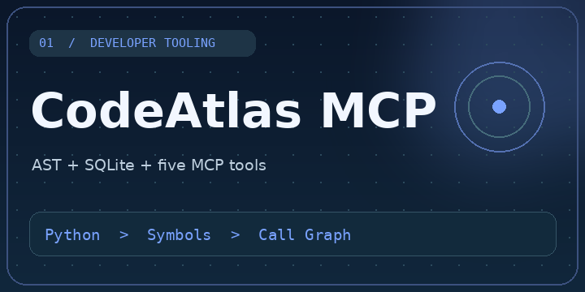
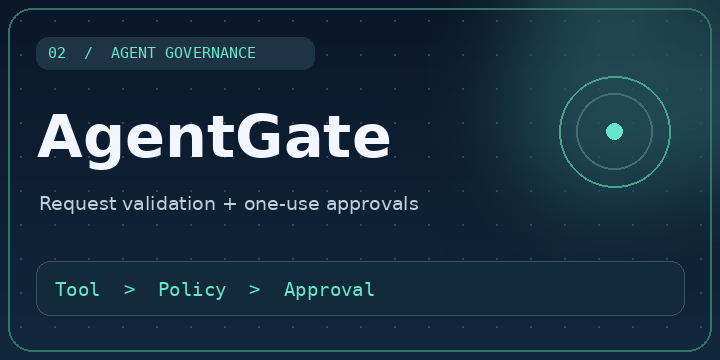
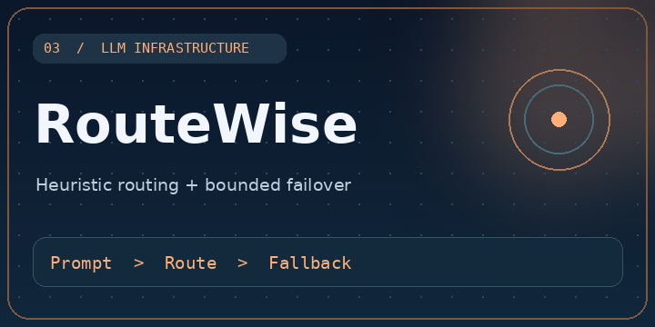

### I turn language models, data, and tools into practical software.

**Generative AI Engineer · Python Backend Developer · Agentic AI**

Building tested backends, retrieval systems, MCP integrations, and AI workflows — with source code you can inspect.

  
  
  

**India · Open to international remote AI / Python engineering roles**

---

### ✦ ENGINEERING THAT YOU CAN VERIFY

**03** featured Python projects &nbsp;·&nbsp; **02** hosted APIs &nbsp;·&nbsp; **44** documented tests passing in CI

### ⚡ Featured systems

<table>
  <tr>
    <td width="33%" valign="top">
      
      
<strong>Developer tooling / local MCP</strong>

      
Local-first code structure search, static call graphs and potential impacted tests. Five MCP tools over Python AST and SQLite.

      
<a href="https://kyaswanthneeli-stack.github.io/projects/codeatlas-mcp.html"><strong>Interactive explorer ↗</strong></a> · <a href="https://github.com/kyaswanthneeli-stack/codeatlas-mcp">Code ↗</a>

      
    </td>
    <td width="33%" valign="top">
      
      
<strong>Agent safety / deployed API</strong>

      
FastAPI tool-policy gateway with request validation, sensitive-text redaction and one-use approvals. Tool adapters are demos.

      
<a href="https://kyaswanthneeli-stack.github.io/projects/agentgate.html"><strong>Interactive explorer ↗</strong></a> · <a href="https://agentgate-production-00036f18.up.railway.app/docs">Live API ↗</a>

      
    </td>
    <td width="33%" valign="top">
      
      
<strong>LLM infrastructure / deployed API</strong>

      
Deterministic fast/reasoning routing, bounded failover and prompt-free metrics. Live API is in labeled no-provider demo mode.

      
<a href="https://kyaswanthneeli-stack.github.io/projects/routewise.html"><strong>Interactive explorer ↗</strong></a> · <a href="https://routewise-production-c8aefb65.up.railway.app/docs">Live API ↗</a>

      
    </td>
  </tr>
</table>

> **What is real?** Python source and tests are public; AgentGate and RouteWise have Railway-hosted APIs verified by external health/docs/authentication smoke tests. Browser visualizations use labeled simulated data. No paid model inference, production compliance, or unmeasured token savings are claimed.

### 🛠️ My technology stack

**Backend:** Python, FastAPI, Flask, REST APIs, SQL  
**AI engineering:** RAG, LangGraph, LangChain, ADK, MCP, LLM APIs  
**Search and data:** ChromaDB, Milvus, PostgreSQL, BigQuery, Azure Cognitive Search  
**Delivery:** Azure, AWS, Docker, Railway, GitHub Actions

### ◇ Explore the AI engineering lab

| Live project | What you can try |
|:--|:--|
| 🔎 **[SourceDesk](https://kyaswanthneeli-stack.github.io/sourcedesk/)** | BM25 document retrieval, source inspection, local text import and evaluation |
| 🧪 **[EvalBench](https://kyaswanthneeli-stack.github.io/ai-engineering-lab/evalbench.html)** | Compare saved answers and inspect lexical quality regressions |
| 🧭 **[TraceFlow](https://kyaswanthneeli-stack.github.io/ai-engineering-lab/traceflow.html)** | Trace simulated retries, cancellation and tool-call budgets |

### 💼 Professional engineering focus

- **Enterprise knowledge assistants:** ingestion, chunking, embeddings, retrieval and context-supported responses.
- **Agentic business search:** multi-step orchestration connecting natural-language questions with structured business information.
- **Conversational voice AI:** speech recognition, Python backends, tool workflows and speech generation.

*Professional project descriptions are experience overviews. No confidential customer repositories or data are published here.*

### ↗ Proof, not just screenshots

- [**GitHub Actions test suites**](https://github.com/kyaswanthneeli-stack/codeatlas-mcp/actions) for the featured Python repositories.
- [**Verified public API checks**](https://github.com/kyaswanthneeli-stack/agentgate/actions/workflows/deployment-smoke.yml) for hosted services.
- [**CodeAtlas architecture and real tokenizer comparisons**](https://github.com/kyaswanthneeli-stack/codeatlas-mcp/blob/main/docs/ARCHITECTURE_AND_BENCHMARK.md), with limits explained.
- [**Captioned video architecture walkthroughs**](https://github.com/kyaswanthneeli-stack/codeatlas-mcp/actions/workflows/walkthrough.yml).

---

### Let's build AI that actually works.

**Open to Generative AI Engineer · AI Backend Engineer · Agentic AI Engineer · Python Developer roles**

<a href="https://kyaswanthneeli-stack.github.io/"><b>Explore the animated portfolio ↗</b></a> &nbsp;·&nbsp; <a href="mailto:kyaswanthneeli@gmail.com"><b>Get in touch ↗</b></a>

Animated artwork is generated by the <a href="scripts/build_readme_art.py">reproducible Python renderer</a> in this repository. The surrounding GitHub profile layout is controlled by GitHub.

