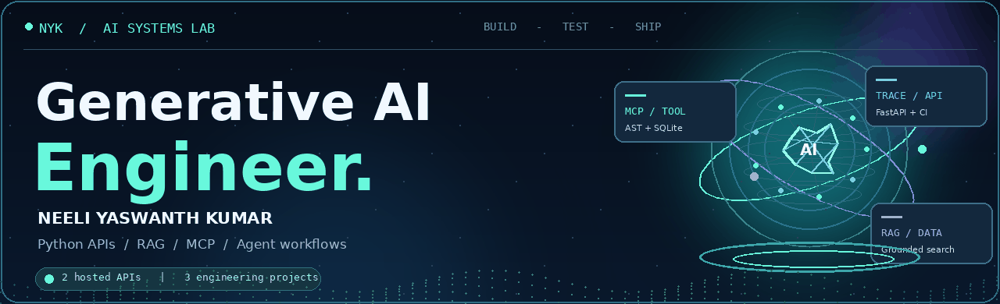
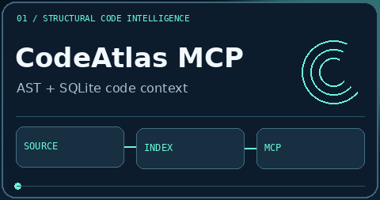
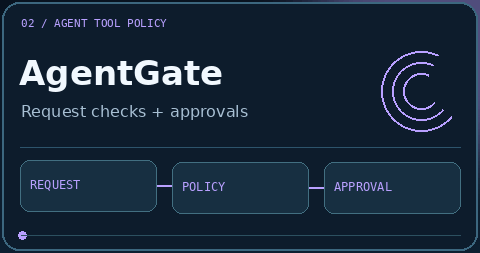
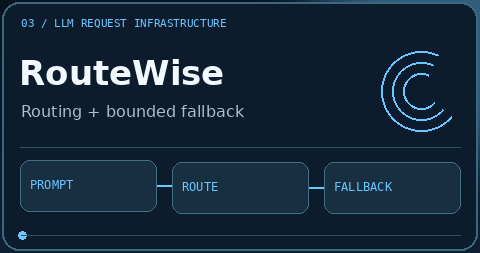
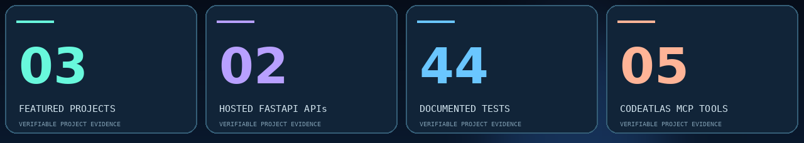

### Engineering the bridge between AI models and real applications.

**Generative AI Engineer** · **Python Backend Developer** · **Agentic AI**

  
  
  
  

### <code>01 //</code> The engineer behind the systems

I’m **Neeli Yaswanth Kumar**. I work on **Generative AI, Python APIs, retrieval systems and agentic workflows**. My public portfolio focuses on understandable architecture, tested code, and practical backend demonstrations.

**What you'll find here:** MCP developer tooling, tool-governance patterns, explainable model routing, evaluation workbenches and real engineering trade-offs.

🌏 **India** · Open to international remote **GenAI / Agentic AI / Python Backend** opportunities.

---

### <code>02 //</code> Featured systems — explore the moving architecture

<table>
<tr>
<td width="33%" valign="top">

**[CodeAtlas MCP](https://github.com/kyaswanthneeli-stack/codeatlas-mcp)**

**Code structure, without reading the whole repository.** Local Python AST indexing, SQLite graph queries, and five MCP tools for coding-agent context.

[**Explore visual demo**](https://kyaswanthneeli-stack.github.io/projects/codeatlas-mcp.html) · [**Architecture**](https://github.com/kyaswanthneeli-stack/codeatlas-mcp/blob/main/docs/ARCHITECTURE_AND_BENCHMARK.md)

</td>
<td width="33%" valign="top">

**[AgentGate](https://github.com/kyaswanthneeli-stack/agentgate)**

**Tool calls deserve guardrails.** A deployed FastAPI policy gateway with allowlists, input checks, redaction, bounded usage and one-use approvals.

[**Try policy demo**](https://kyaswanthneeli-stack.github.io/projects/agentgate.html) · [**Live Python API**](https://agentgate-production-00036f18.up.railway.app/docs)

</td>
<td width="33%" valign="top">

**[RouteWise](https://github.com/kyaswanthneeli-stack/routewise)**

**Route requests intentionally.** A deployed FastAPI gateway for heuristic fast/reasoning selection, bounded failover and protected metrics.

[**Try routing demo**](https://kyaswanthneeli-stack.github.io/projects/routewise.html) · [**Live Python API**](https://routewise-production-c8aefb65.up.railway.app/docs)

</td>
</tr>
</table>

### <code>03 //</code> A closer look at the engineering

Measured engineering scope, not fabricated GitHub stars, followers, streaks, or model cost savings.

### <code>04 //</code> My technology constellation

**Backend engineering:** Python, FastAPI, Flask, REST APIs, SQL

**LLMs and retrieval:** RAG, LangGraph, LangChain, MCP, ChromaDB, Milvus

**Delivery:** Docker, Azure, GitHub Actions, Railway

---

### <code>05 //</code> The experimentation lab

| Experience | What it shows | Try it |
|:--|:--|:--|
| **[SourceDesk](https://github.com/kyaswanthneeli-stack/sourcedesk)** | BM25 retrieval, document source inspection and evaluation | [Open workbench](https://kyaswanthneeli-stack.github.io/sourcedesk/) |
| **[EvalBench](https://github.com/kyaswanthneeli-stack/ai-engineering-lab)** | Lexical saved-answer regression testing | [Open demo](https://kyaswanthneeli-stack.github.io/ai-engineering-lab/evalbench.html) |
| **[TraceFlow](https://github.com/kyaswanthneeli-stack/ai-engineering-lab)** | Simulated retries, budgets and cancellation | [Open demo](https://kyaswanthneeli-stack.github.io/ai-engineering-lab/traceflow.html) |

<strong>Engineering verification, deployment scope and video walkthroughs</strong>

- **CodeAtlas MCP:** [16 documented tests and tokenizer benchmark](https://github.com/kyaswanthneeli-stack/codeatlas-mcp/actions/workflows/ci.yml) · [architecture walkthrough](https://github.com/kyaswanthneeli-stack/codeatlas-mcp/actions/workflows/walkthrough.yml)
- **AgentGate:** [14 documented tests and Docker CI](https://github.com/kyaswanthneeli-stack/agentgate/actions/workflows/ci.yml) · [public health/authentication smoke checks](https://github.com/kyaswanthneeli-stack/agentgate/actions/workflows/deployment-smoke.yml)
- **RouteWise:** [14 documented tests and Docker CI](https://github.com/kyaswanthneeli-stack/routewise/actions/workflows/ci.yml) · [public health/authentication smoke checks](https://github.com/kyaswanthneeli-stack/routewise/actions/workflows/deployment-smoke.yml)

**Accurate boundaries:** The browser experiences are simulations. AgentGate uses fixed tool adapters (no real notifications). RouteWise's hosted backend is in explicitly labeled no-provider demo mode until real provider credentials are configured. CodeAtlas has genuine tokenizer payload measurements, not proven end-to-end LLM token savings. The videos are captioned architecture explainers.

---

### Let's build something worth shipping.

Interested in **Generative AI Engineer**, **Agentic AI Engineer**, and **Python Backend Engineer** opportunities.

[**Portfolio**](https://kyaswanthneeli-stack.github.io/) &nbsp; · &nbsp; [**LinkedIn**](https://www.linkedin.com/in/yaswanthneeli-kumar-134a74414/) &nbsp; · &nbsp; [**Email**](mailto:kyaswanthneeli@gmail.com)

Floating graphics are real looping GIF animations, built with [the open-source portfolio animation script](scripts/build_floating_portfolio.py) and [GitHub Actions](https://github.com/kyaswanthneeli-stack/kyaswanthneeli-stack/actions/workflows/floating-profile.yml). GitHub controls the avatar and surrounding sidebar.

