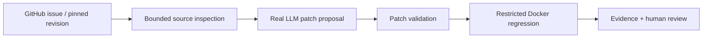

# Neeli Yaswanth Kumar

### Generative AI · Agentic Systems · Python Backend Engineering

I build **Python APIs and tools for evaluating and operating LLM workflows**. My public projects cover patch verification, tool-call approval, model routing, and source-code indexing.

[**Explore my portfolio**](https://kyaswanthneeli-stack.github.io/) &nbsp; / &nbsp; [LinkedIn](https://www.linkedin.com/in/yaswanthneeli-kumar/) &nbsp; / &nbsp; [Email](mailto:kyaswanthneeli@gmail.com)

**Available from India for international remote AI engineering and Python backend roles and paid contracts.**

---

## Flagship project · RepoPilot

**A human-supervised coding agent that proposes Python patches for GitHub issues and records how they were verified.**

| **351** | **2 files** | **v2.2.0** |
| :---: | :---: | :---: |
| Unit tests passed on the final maintenance branch | Real model-generated coordinated repair on a controlled issue | Published wheel, source archive and documented CLI image |

**The problem:** LLM-generated patches can look convincing without fixing the issue. RepoPilot makes verification and developer review part of the workflow.

**Engineering decisions:** inspect bounded source windows; constrain edits to inspected files; verify candidates without host shell access; reject new Python compilation errors; retain provenance and independent evaluator evidence. A developer reviews the candidate before publication and merge.

**Verified case:** Qwen generated a two-module invoice repair; curated regression tests failed before the patch and passed afterward in restricted Docker. The candidate was published and merged after human review and corrections. The independent SWE-bench Lite baseline is **1/12 selected issues resolved (8.3%), 1/4 submitted patches resolved**. Further autonomy research is separate from the completed supervised portfolio release.

[**Interactive case study**](https://kyaswanthneeli-stack.github.io/ai-engineering-lab/repopilot/recruiter-demo.html) · [**Source and setup**](https://github.com/kyaswanthneeli-stack/ai-engineering-lab/tree/main/repopilot) · [**Release**](https://github.com/kyaswanthneeli-stack/ai-engineering-lab/releases/tag/v2.2.0) · [**Actual model run**](https://github.com/kyaswanthneeli-stack/ai-engineering-lab/actions/runs/44540507015) · [**Final audit**](https://github.com/kyaswanthneeli-stack/ai-engineering-lab/blob/main/repopilot/docs/FINAL_PORTFOLIO_AUDIT.md)

---

## Selected AI engineering projects

| System | Problem solved / implementation | Explore |
| :--- | :--- | :--- |
| **CodeAtlas MCP** | Python AST and SQLite snapshot; five local MCP tools for symbols, candidate call graphs and test impact. | [Code](https://github.com/kyaswanthneeli-stack/codeatlas-mcp) · [Architecture](https://kyaswanthneeli-stack.github.io/projects/codeatlas-guide.html) · [Demo](https://kyaswanthneeli-stack.github.io/projects/codeatlas-mcp.html) |
| **AgentGate** | FastAPI tool-policy gateway with allowlists, argument validation, redaction, atomic call limits and request-bound one-use approvals. | [Code](https://github.com/kyaswanthneeli-stack/agentgate) · [Demo](https://kyaswanthneeli-stack.github.io/projects/agentgate.html) · [API docs](https://agentgate-production-00036f18.up.railway.app/docs) |
| **RouteWise** | FastAPI LLM gateway with deterministic routing, authenticated requests, bounded retry and provider fallback. Public route inspection is separate from private inference. | [Code](https://github.com/kyaswanthneeli-stack/routewise) · [Demo](https://kyaswanthneeli-stack.github.io/projects/routewise.html) · [API docs](https://routewise-production-c8aefb65.up.railway.app/docs) |

<strong>Architecture walkthroughs and verification</strong>

| Project | Evidence |
| :--- | :--- |
| CodeAtlas | [16 documented tests and CI](https://github.com/kyaswanthneeli-stack/codeatlas-mcp/actions/workflows/ci.yml) · [Architecture and benchmark methodology](https://github.com/kyaswanthneeli-stack/codeatlas-mcp/blob/main/docs/ARCHITECTURE_AND_BENCHMARK.md) |
| AgentGate | [AgentGate CI](https://github.com/kyaswanthneeli-stack/agentgate/actions/workflows/ci.yml) · [Deployment smoke workflow](https://github.com/kyaswanthneeli-stack/agentgate/actions/workflows/deployment-smoke.yml) |
| RouteWise | [RouteWise CI](https://github.com/kyaswanthneeli-stack/routewise/actions/workflows/ci.yml) · [Deployment smoke workflow](https://github.com/kyaswanthneeli-stack/routewise/actions/workflows/deployment-smoke.yml) |

CodeAtlas is a local Python MCP service with a sample browser graph. AgentGate uses simulated tool adapters, not real notifications. RouteWise's routing preview does not call a model; authenticated inference depends on the server's provider configuration. Hosted endpoints are linked, not a guarantee of uptime. RepoPilot is a supervised prototype, not a multi-tenant autonomous service. Each repository explains its test and measurement boundaries.

## Retrieval, evaluation and orchestration lab

| Project | Focus | Try |
| :--- | :--- | :--- |
| **SourceDesk** | BM25 versus keyword overlap, document evidence, retrieval evaluation | [Workbench](https://kyaswanthneeli-stack.github.io/sourcedesk/) · [Source](https://github.com/kyaswanthneeli-stack/sourcedesk) |
| **EvalBench** | Saved-answer regression detection, lexical metrics and required-phrase checks | [Demo](https://kyaswanthneeli-stack.github.io/ai-engineering-lab/evalbench.html) · [Source](https://github.com/kyaswanthneeli-stack/ai-engineering-lab) |
| **TraceFlow** | Async workflow simulation, retries, cancellation, budgets and evidence traces | [Demo](https://kyaswanthneeli-stack.github.io/ai-engineering-lab/traceflow.html) · [Source](https://github.com/kyaswanthneeli-stack/ai-engineering-lab) |

These browser labs use deterministic examples and synthetic data, not live model responses.

## Technical focus

| Area | Technologies and design practices |
| :--- | :--- |
| AI engineering | LLM integration, RAG, tool calling, agent orchestration, MCP, retrieval evaluation |
| Python backend | Python, FastAPI, Flask, REST APIs, SQL, SQLite, asynchronous processing |
| Reliability | Validation, bounded retries, provider fallback, human approval, regression tests |
| Delivery | Docker, GitHub Actions, Railway, Azure |

The portfolio also includes architecture-level case studies of knowledge retrieval, product/order search and voice workflows. Private client code and data are not published.

## Start here

For a technical interview, start with the [RepoPilot case study](https://kyaswanthneeli-stack.github.io/ai-engineering-lab/repopilot/recruiter-demo.html), then inspect the [code and release](https://github.com/kyaswanthneeli-stack/ai-engineering-lab/tree/main/repopilot). For API design, explore [AgentGate](https://kyaswanthneeli-stack.github.io/projects/agentgate-guide.html) or [RouteWise](https://kyaswanthneeli-stack.github.io/projects/routewise-guide.html). For retrieval and MCP, see [CodeAtlas](https://kyaswanthneeli-stack.github.io/projects/codeatlas-guide.html).

[Portfolio](https://kyaswanthneeli-stack.github.io/) · [LinkedIn](https://www.linkedin.com/in/yaswanthneeli-kumar/) · [Contact](mailto:kyaswanthneeli@gmail.com)
