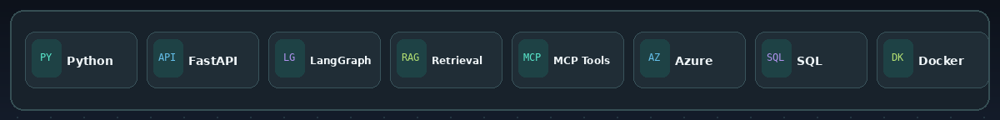
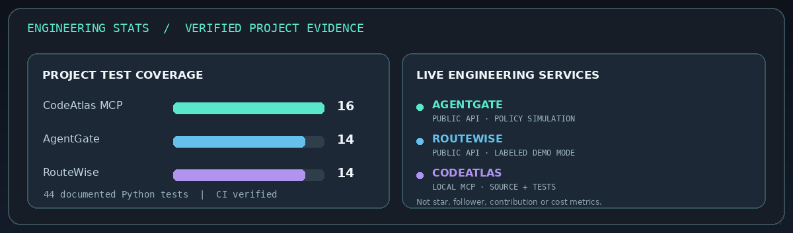

### Generative AI Engineer · Python Backend Developer · Agentic AI

**Building real Python backends, retrieval systems, MCP integrations and tested AI workflows.**

   

### 👋 About me

I'm **Neeli Yaswanth Kumar**. I build AI applications and Python backend services that connect language models to real business information and tools.

- 🔭 **What I build:** RAG pipelines, MCP tools, FastAPI services and agent workflows
- ⚙️ **Engineering interests:** reliability, tool policies, retrieval quality, testing and deployment
- 🚀 **Public evidence:** repositories, passing tests, architecture explanations and deployed API documentation
- 🌏 **Career:** open to Generative AI and Python engineering roles, including international remote opportunities

### 🛠️ Languages, frameworks and tools

  

**Also working with:** LangChain · ADK · ChromaDB · Milvus · BigQuery · GitHub Actions · Railway · REST APIs

---

### ✦ Selected engineering projects

<table>
<tr>
<td width="33%" valign="top">
  
  <h3>CodeAtlas MCP</h3>
  
<b>Structure-aware coding agent context</b>

  
Python AST + SQLite index with five MCP tools, symbol queries, static call graphs and potential test-impact discovery.

  
<a href="https://kyaswanthneeli-stack.github.io/projects/codeatlas-mcp.html">Try demo ↗</a> · <a href="https://github.com/kyaswanthneeli-stack/codeatlas-mcp">Source ↗</a>

  
</td>
<td width="33%" valign="top">
  
  <h3>AgentGate</h3>
  
<b>Safety policies for AI tool calls</b>

  
Hosted FastAPI policy gateway with allowlists, PII redaction, bounded calls and one-use approvals. Simulated tool execution.

  
<a href="https://kyaswanthneeli-stack.github.io/projects/agentgate.html">Try demo ↗</a> · <a href="https://agentgate-production-00036f18.up.railway.app/docs">Live API ↗</a>

  
</td>
<td width="33%" valign="top">
  
  <h3>RouteWise</h3>
  
<b>Explainable LLM routing and fallback</b>

  
FastAPI routing, bounded provider failover and authenticated metrics. Hosted API uses explicitly labeled no-provider demo responses.

  
<a href="https://kyaswanthneeli-stack.github.io/projects/routewise.html">Try demo ↗</a> · <a href="https://routewise-production-c8aefb65.up.railway.app/docs">Live API ↗</a>

  
</td>
</tr>
</table>

### 📊 Engineering stats

  

These are real documented engineering counts, not invented stars, follower totals, commits or contribution streaks. GitHub displays its authentic contribution calendar on the profile itself.

### 🔬 Other working demos

| Project | Interactive workbench | Focus |
|:--|:--|:--|
| **[SourceDesk](https://github.com/kyaswanthneeli-stack/sourcedesk)** | [Explore](https://kyaswanthneeli-stack.github.io/sourcedesk/) | BM25 retrieval, document source inspection and evaluation |
| **[EvalBench](https://github.com/kyaswanthneeli-stack/ai-engineering-lab)** | [Explore](https://kyaswanthneeli-stack.github.io/ai-engineering-lab/evalbench.html) | Saved-answer lexical evaluation and regression |
| **[TraceFlow](https://github.com/kyaswanthneeli-stack/ai-engineering-lab)** | [Explore](https://kyaswanthneeli-stack.github.io/ai-engineering-lab/traceflow.html) | Simulated async workflow retries and traces |

<b>▸ Architecture, benchmarks and evidence</b>

- [CodeAtlas architecture and tokenizer benchmark](https://github.com/kyaswanthneeli-stack/codeatlas-mcp/blob/main/docs/ARCHITECTURE_AND_BENCHMARK.md) · [16 documented tests](https://github.com/kyaswanthneeli-stack/codeatlas-mcp/actions/workflows/ci.yml)
- [AgentGate architecture](https://github.com/kyaswanthneeli-stack/agentgate/blob/main/docs/ARCHITECTURE_AND_DEMO.md) · [14 documented tests](https://github.com/kyaswanthneeli-stack/agentgate/actions/workflows/ci.yml) · [Public API check](https://github.com/kyaswanthneeli-stack/agentgate/actions/workflows/deployment-smoke.yml)
- [RouteWise architecture](https://github.com/kyaswanthneeli-stack/routewise/blob/main/docs/ARCHITECTURE_AND_DEMO.md) · [14 documented tests](https://github.com/kyaswanthneeli-stack/routewise/actions/workflows/ci.yml) · [Public API check](https://github.com/kyaswanthneeli-stack/routewise/actions/workflows/deployment-smoke.yml)

The browser demos are clearly labeled simulations. AgentGate's example tools do not perform external actions; RouteWise requires server-side provider credentials for real model inference. CodeAtlas's tokenizer measurement does not prove end-to-end agent token savings.

---

### Let's work on AI that actually ships.

**Generative AI Engineer · Python Backend Engineer · Agentic AI Engineer**

[**Portfolio**](https://kyaswanthneeli-stack.github.io/) · [**LinkedIn**](https://www.linkedin.com/in/yaswanthneeli-kumar-134a74414/) · [**GitHub**](https://github.com/kyaswanthneeli-stack?tab=repositories) · [**Email**](mailto:kyaswanthneeli@gmail.com)

Original developer-themed artwork is generated by the reproducible <a href="scripts/build_reference_readme.py">README graphic renderer</a>. GitHub owns the surrounding page layout and appearance.

