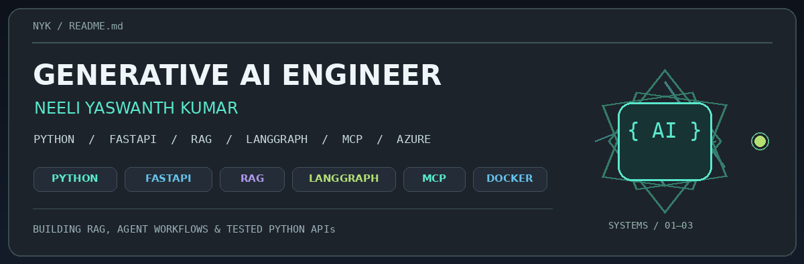
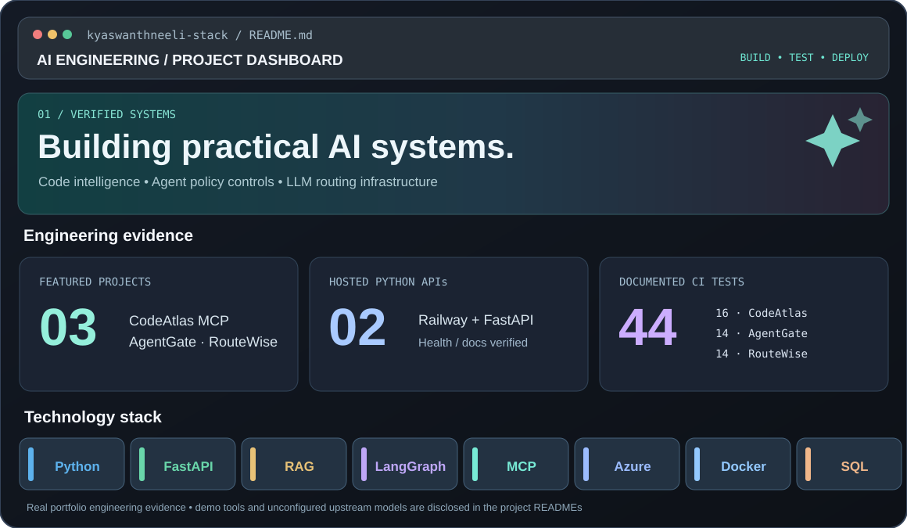
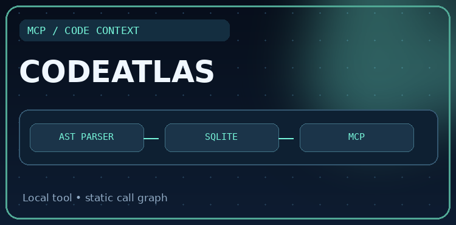
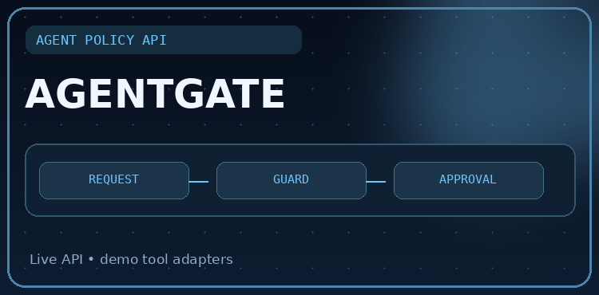

### About me ☕

- 👨‍💻 I'm **Neeli Yaswanth Kumar**, focused on **Generative AI, Agentic AI and Python backend engineering**.
- 🛠️ I build **FastAPI services, RAG pipelines, MCP tools and LLM integration workflows**.
- 🧪 My public projects include **reproducible tests, architecture diagrams and verified API demonstrations**.
- 🌍 I'm open to **remote Generative AI Engineer, Agentic AI Engineer and Python Developer** opportunities.
- 🔗 [Portfolio](https://kyaswanthneeli-stack.github.io/) · [LinkedIn](https://www.linkedin.com/in/yaswanthneeli-kumar-134a74414/) · [Contact](mailto:kyaswanthneeli@gmail.com)

---

### Latest engineering work 📌

- **[CodeAtlas MCP](https://github.com/kyaswanthneeli-stack/codeatlas-mcp)** — Python AST + SQLite structural context for coding assistants, five MCP tools and call-graph queries. [Explore demo](https://kyaswanthneeli-stack.github.io/projects/codeatlas-mcp.html).
- **[AgentGate](https://github.com/kyaswanthneeli-stack/agentgate)** — Hosted Python API for tool policies, redaction and one-use approvals. [Live API docs](https://agentgate-production-00036f18.up.railway.app/docs) · [Browser demo](https://kyaswanthneeli-stack.github.io/projects/agentgate.html).
- **[RouteWise](https://github.com/kyaswanthneeli-stack/routewise)** — Hosted explainable routing gateway, failover and request metrics. [Live API docs](https://routewise-production-c8aefb65.up.railway.app/docs) · [Browser demo](https://kyaswanthneeli-stack.github.io/projects/routewise.html).

---

### Engineering dashboard 📊

Dashboard figures are verified project facts rather than fabricated follower, star, contribution or streak statistics. GitHub's genuine contribution activity remains visible below the README.

**Additional tools:** LangChain · ADK · REST APIs · BigQuery · ChromaDB · Milvus · GitHub Actions · Railway

---

### Featured projects 🚀

<table>
<tr>
<td width="33%" valign="top">
  
  
<b>CodeAtlas MCP</b> Code structure, call graphs, MCP stdio server

  
  
<a href="https://github.com/kyaswanthneeli-stack/codeatlas-mcp/blob/main/docs/ARCHITECTURE_AND_BENCHMARK.md">Architecture & benchmark ↗</a>

</td>
<td width="33%" valign="top">
  
  
<b>AgentGate</b> Tool allowlists, redaction, request-bound approvals

  
  
<a href="https://github.com/kyaswanthneeli-stack/agentgate/blob/main/docs/ARCHITECTURE_AND_DEMO.md">Architecture & walkthrough ↗</a>

</td>
<td width="33%" valign="top">
  
  
<b>RouteWise</b> Heuristic model routing, failover, metrics

  
  
<a href="https://github.com/kyaswanthneeli-stack/routewise/blob/main/docs/ARCHITECTURE_AND_DEMO.md">Architecture & walkthrough ↗</a>

</td>
</tr>
</table>

### Other interactive projects

[**SourceDesk — Retrieval workbench**](https://kyaswanthneeli-stack.github.io/sourcedesk/) · [**EvalBench — Answer evaluation**](https://kyaswanthneeli-stack.github.io/ai-engineering-lab/evalbench.html) · [**TraceFlow — Workflow tracing**](https://kyaswanthneeli-stack.github.io/ai-engineering-lab/traceflow.html)

<b>Explore technical details and limitations</b>

- **CodeAtlas:** AST-based candidate graphs and a local MCP server. [Tests and measured tokenizer counts](https://github.com/kyaswanthneeli-stack/codeatlas-mcp/actions/workflows/ci.yml). Token payload size alone does not prove agent cost savings.
- **AgentGate:** Live FastAPI endpoints with fixed, simulated tool adapters; sensitive requests require credentials and some actions require approvals. [API security checks](https://github.com/kyaswanthneeli-stack/agentgate/actions/workflows/deployment-smoke.yml).
- **RouteWise:** Live FastAPI with labeled fixture responses until provider credentials are configured. Browser failures and examples are simulated. [API security checks](https://github.com/kyaswanthneeli-stack/routewise/actions/workflows/deployment-smoke.yml).
- [Project architecture explainer videos](https://github.com/kyaswanthneeli-stack/agentgate/actions/workflows/walkthrough.yml) are captioned animations, not recorded live model calls.

---

### Let's build useful AI together 🤝

**Generative AI Engineer | Python Backend Engineer | Agentic AI Engineer**

<a href="https://kyaswanthneeli-stack.github.io/">Portfolio</a> ·
<a href="https://www.linkedin.com/in/yaswanthneeli-kumar-134a74414/">LinkedIn</a> ·
<a href="mailto:kyaswanthneeli@gmail.com">Email</a>

Dark developer graphics generated with the <a href="scripts/build_reference_readme.py">reproducible Python renderer</a>. The surrounding GitHub layout and profile avatar are controlled by GitHub.

