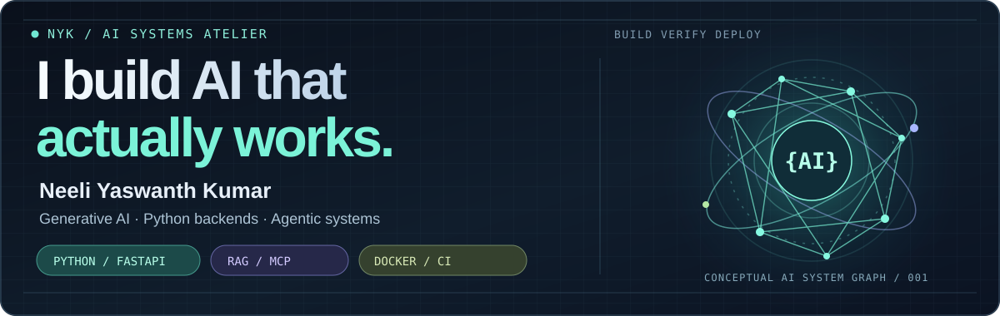
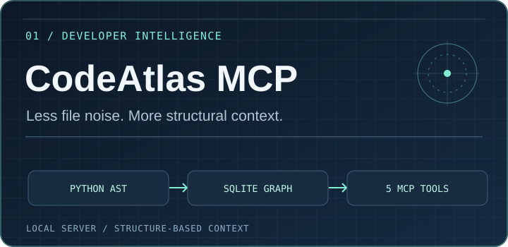
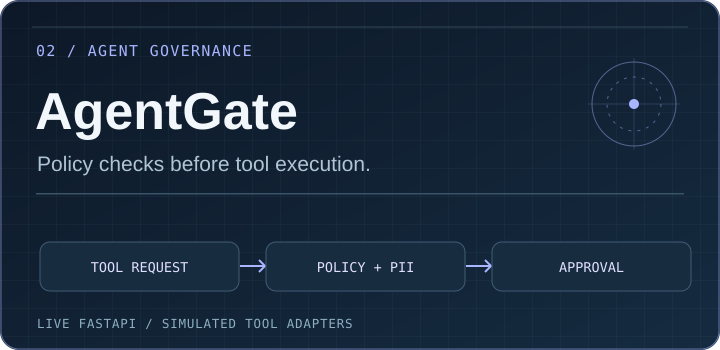
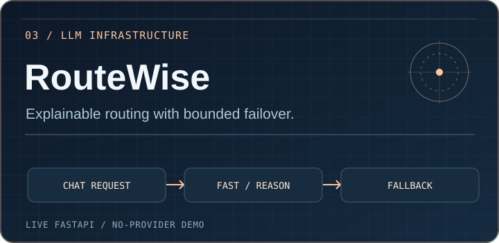

 

**Generative AI Engineer** &nbsp; • &nbsp; **Python Backend Developer** &nbsp; • &nbsp; **Agentic AI**

*Building reliable Python services, retrieval systems, and useful AI tools.*

  
  
  
  

---

### ✦ Selected engineering work

Three focused Python projects. Real source code, automated tests, architecture notes and clearly labeled demonstrations.

<table>
<tr>
<td width="33%" valign="top">

**01 / [CodeAtlas MCP](https://github.com/kyaswanthneeli-stack/codeatlas-mcp)**

Structural context for coding assistants. Index Python symbols and static call relationships, then query them through five MCP tools.

[Interactive graph](https://kyaswanthneeli-stack.github.io/projects/codeatlas-mcp.html) · [Technical methodology](https://github.com/kyaswanthneeli-stack/codeatlas-mcp/blob/main/docs/ARCHITECTURE_AND_BENCHMARK.md)

</td>
<td width="33%" valign="top">

**02 / [AgentGate](https://github.com/kyaswanthneeli-stack/agentgate)**

FastAPI policy gateway with tool allowlists, recursive redaction, session limits and one-use approvals.

[Interactive simulator](https://kyaswanthneeli-stack.github.io/projects/agentgate.html) · [Live API documentation](https://agentgate-production-00036f18.up.railway.app/docs)

</td>
<td width="33%" valign="top">

**03 / [RouteWise](https://github.com/kyaswanthneeli-stack/routewise)**

Explainable FastAPI LLM routing with deterministic model selection, bounded failover and protected metrics.

[Routing simulator](https://kyaswanthneeli-stack.github.io/projects/routewise.html) · [Live API documentation](https://routewise-production-c8aefb65.up.railway.app/docs)

</td>
</tr>
</table>

---

### ✦ Engineering evidence

| 03 | 02 | 44 | 05 |
|:--:|:--:|:--:|:--:|
| **Featured projects** | **Hosted FastAPI services** | **Documented Python tests** | **CodeAtlas MCP tools** |

These figures describe the actual repositories—not invented GitHub contributions, followers, stars, or model cost reductions. The 44 documented tests are split across CodeAtlas (16), AgentGate (14), and RouteWise (14). Public health/documentation/authentication checks have passed for the two hosted APIs.

**Scope:** CodeAtlas’s browser graph uses a sample fixture; AgentGate’s example tool adapters are simulated; RouteWise is publicly deployed with a labeled *no-provider demo mode*. Live model inference is **not** claimed.

### ✦ Technology and capabilities

**Backend:** Python, FastAPI, Flask, REST APIs, SQL  
**LLMs and agents:** RAG, LangChain, LangGraph, MCP, agent workflows  
**Retrieval and cloud:** ChromaDB, Milvus, BigQuery, Azure, Docker

---

### ✦ Inside the lab

| Explore | What you'll find |
|:--|:--|
| **[SourceDesk](https://kyaswanthneeli-stack.github.io/sourcedesk/)** | BM25 search, source inspection and retrieval evaluation |
| **[EvalBench](https://kyaswanthneeli-stack.github.io/ai-engineering-lab/evalbench.html)** | Transparent saved-answer regression checks |
| **[TraceFlow](https://kyaswanthneeli-stack.github.io/ai-engineering-lab/traceflow.html)** | Simulated agent retries, cancellation and tool budgets |

<strong>Read project architecture and view walkthroughs</strong>

- [CodeAtlas architecture and token measurement](https://github.com/kyaswanthneeli-stack/codeatlas-mcp/blob/main/docs/ARCHITECTURE_AND_BENCHMARK.md) · [Captioned video](https://github.com/kyaswanthneeli-stack/codeatlas-mcp/actions/workflows/walkthrough.yml)
- [AgentGate security design](https://github.com/kyaswanthneeli-stack/agentgate/blob/main/docs/ARCHITECTURE_AND_DEMO.md) · [Captioned video](https://github.com/kyaswanthneeli-stack/agentgate/actions/workflows/walkthrough.yml)
- [RouteWise failure handling](https://github.com/kyaswanthneeli-stack/routewise/blob/main/docs/ARCHITECTURE_AND_DEMO.md) · [Captioned video](https://github.com/kyaswanthneeli-stack/routewise/actions/workflows/walkthrough.yml)

Walkthroughs are architecture explainers, not recordings of live external model calls.

---

### Let's build something worth shipping.

Interested in **Generative AI**, **Agentic AI**, and **Python backend engineering** roles.

[**Explore my portfolio**](https://kyaswanthneeli-stack.github.io/) &nbsp; · &nbsp; [**Connect on LinkedIn**](https://www.linkedin.com/in/yaswanthneeli-kumar-134a74414/) &nbsp; · &nbsp; [**Email me**](mailto:kyaswanthneeli@gmail.com)

Original SVG artwork created for this GitHub profile. The surrounding GitHub interface and avatar are controlled by GitHub.

