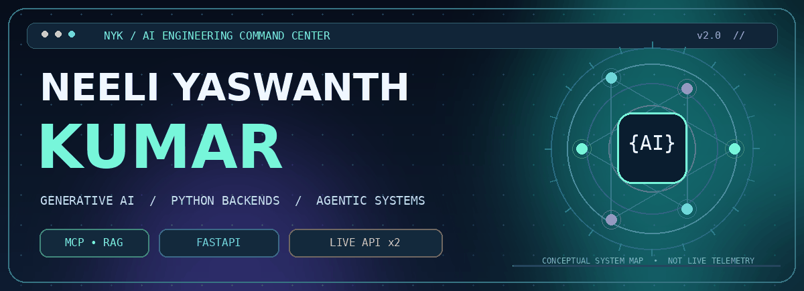
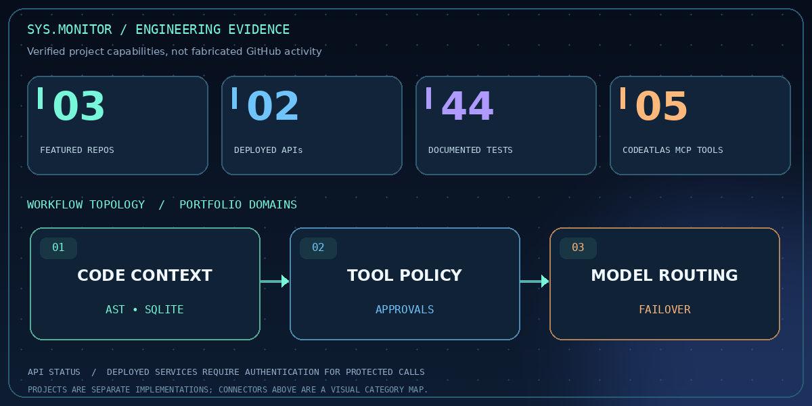
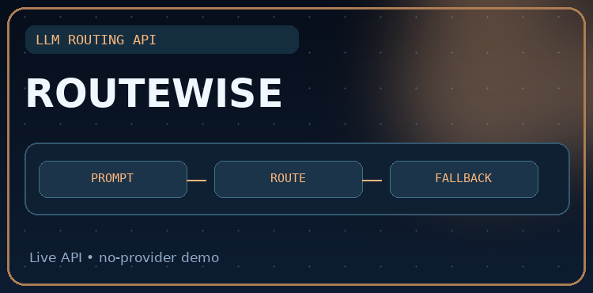
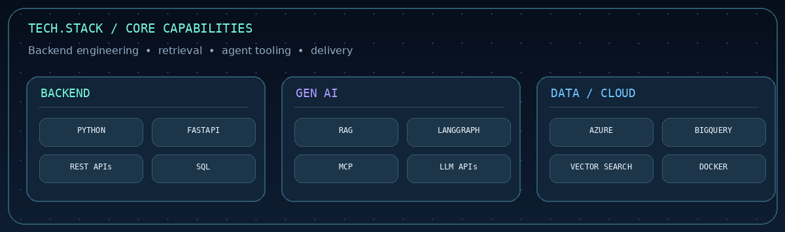

### AI SYSTEMS ENGINEER • PYTHON BACKENDS • AGENTIC WORKFLOWS

**I build practical AI systems you can inspect—not just demos you can watch.**

Backend APIs · Retrieval-Augmented Generation · Agent tooling · MCP · Evaluation

  
  
  

Based in India · Interested in international remote Generative AI and Python backend roles

---

### 01 // MISSION CONTROL

These are documented portfolio engineering facts—not GitHub contribution counts, performance benchmarks or invented live telemetry.

## 02 // FEATURED SYSTEMS

<table>
<tr>
<td width="33%" valign="top">
  
  <h3>CodeAtlas MCP</h3>
  <b>Structural context for coding agents</b>
  
Local Python AST indexing, SQLite graphs, five stdio MCP tools and potential test-impact queries.

  
<a href="https://kyaswanthneeli-stack.github.io/projects/codeatlas-mcp.html"><b>Interactive graph ↗</b></a> <a href="https://github.com/kyaswanthneeli-stack/codeatlas-mcp"><b>Source + architecture ↗</b></a>

  
</td>
<td width="33%" valign="top">
  
  <h3>AgentGate</h3>
  <b>Governance for AI tool calls</b>
  
Hosted FastAPI policy gateway with allowlists, nested redaction and one-use request-bound approvals.

  
<a href="https://kyaswanthneeli-stack.github.io/projects/agentgate.html"><b>Policy explorer ↗</b></a> <a href="https://agentgate-production-00036f18.up.railway.app/docs"><b>Live Swagger API ↗</b></a>

  
</td>
<td width="33%" valign="top">
  
  <h3>RouteWise</h3>
  <b>Explainable LLM traffic routing</b>
  
Hosted FastAPI routing, provider failover and protected request metrics. No upstream model configured.

  
<a href="https://kyaswanthneeli-stack.github.io/projects/routewise.html"><b>Routing explorer ↗</b></a> <a href="https://routewise-production-c8aefb65.up.railway.app/docs"><b>Live Swagger API ↗</b></a>

  
</td>
</tr>
</table>

> **Reality check:** Both FastAPI services are deployed with protected endpoints and verified health/docs checks. The browser explorers remain simulations. AgentGate has fixed demo tool adapters; RouteWise's live API uses explicitly labeled no-provider responses until real model credentials are configured. CodeAtlas's token counts are payload comparisons, not proven agent cost savings.

### 03 // TECHNICAL ARSENAL

Also: Flask · LangChain · ADK · ChromaDB · Milvus · PostgreSQL · GitHub Actions · Railway

## 04 // ENGINEERING EVIDENCE

| System | Verification | Details |
|:--|:--|:--|
| **CodeAtlas MCP** | [16 documented tests, CI and tokenizer benchmark](https://github.com/kyaswanthneeli-stack/codeatlas-mcp/actions/workflows/ci.yml) | [Architecture and measurement limitations](https://github.com/kyaswanthneeli-stack/codeatlas-mcp/blob/main/docs/ARCHITECTURE_AND_BENCHMARK.md) |
| **AgentGate** | [14 documented tests and Docker CI](https://github.com/kyaswanthneeli-stack/agentgate/actions/workflows/ci.yml) | [Live API verification](https://github.com/kyaswanthneeli-stack/agentgate/actions/workflows/deployment-smoke.yml) |
| **RouteWise** | [14 documented tests and Docker CI](https://github.com/kyaswanthneeli-stack/routewise/actions/workflows/ci.yml) | [Live API verification](https://github.com/kyaswanthneeli-stack/routewise/actions/workflows/deployment-smoke.yml) |

<b>▸ Inspect architecture and video walkthroughs</b>

- **CodeAtlas:** [architecture and benchmark design](https://github.com/kyaswanthneeli-stack/codeatlas-mcp/blob/main/docs/ARCHITECTURE_AND_BENCHMARK.md) · [captioned MP4 explainer](https://github.com/kyaswanthneeli-stack/codeatlas-mcp/actions/workflows/walkthrough.yml)
- **AgentGate:** [architecture and authorization flow](https://github.com/kyaswanthneeli-stack/agentgate/blob/main/docs/ARCHITECTURE_AND_DEMO.md) · [captioned MP4 explainer](https://github.com/kyaswanthneeli-stack/agentgate/actions/workflows/walkthrough.yml)
- **RouteWise:** [architecture and failure handling](https://github.com/kyaswanthneeli-stack/routewise/blob/main/docs/ARCHITECTURE_AND_DEMO.md) · [captioned MP4 explainer](https://github.com/kyaswanthneeli-stack/routewise/actions/workflows/walkthrough.yml)

The videos are silent architecture explainers, not recordings of live model use.

## 05 // EXPERIMENTAL LAB

| Explore | Focus |
|:--|:--|
| [**SourceDesk** — Retrieval Workbench](https://kyaswanthneeli-stack.github.io/sourcedesk/) | BM25, document evidence, source inspection and evaluation |
| [**EvalBench** — Answer Regression](https://kyaswanthneeli-stack.github.io/ai-engineering-lab/evalbench.html) | Lexical saved-answer checks and reproducible evaluations |
| [**TraceFlow** — Workflow Tracing](https://kyaswanthneeli-stack.github.io/ai-engineering-lab/traceflow.html) | Simulated async calls, retries, cancellation and budgets |

## 06 // REAL-WORLD ENGINEERING FOCUS

**Retrieval systems:** ingestion, chunking, embeddings, vector search and grounded answer workflows.  
**Agentic business search:** multi-step query orchestration, BigQuery-backed retrieval, MCP tool integrations.  
**Voice AI:** speech recognition, Python services, conversational intent and speech output.

*These describe professional engineering experience; client code and private data are not published.*

---

### TRANSMISSION READY // LET'S BUILD SOMETHING USEFUL

Interested in **Generative AI Engineer**, **Agentic AI Engineer**, or **Python Backend Engineer** opportunities.

<a href="https://kyaswanthneeli-stack.github.io/"><b>ENTER PORTFOLIO ↗</b></a> &nbsp;•&nbsp;
<a href="https://www.linkedin.com/in/yaswanthneeli-kumar-134a74414/"><b>LINKEDIN ↗</b></a> &nbsp;•&nbsp;
<a href="mailto:kyaswanthneeli@gmail.com"><b>CONTACT ↗</b></a>

The illustrations are original, generated by the <a href="scripts/build_cyber_dashboard.py">reproducible Python renderer</a>. GitHub controls the surrounding profile layout; this command-center design lives inside the README.

