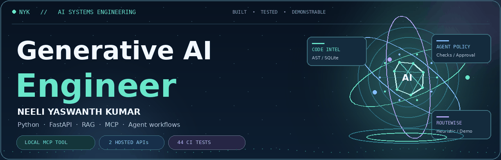
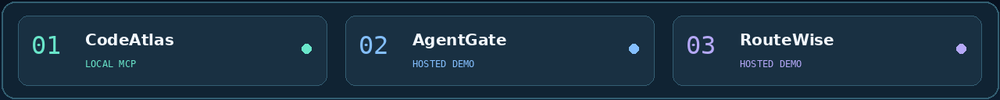
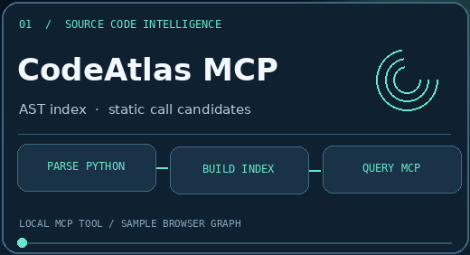
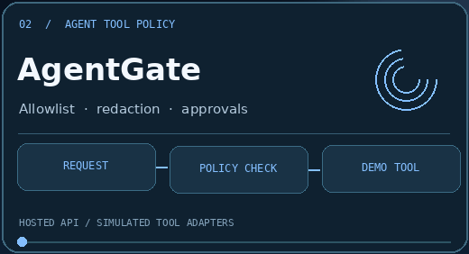
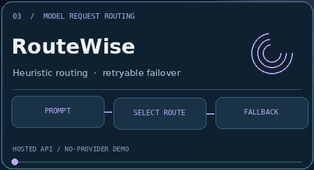
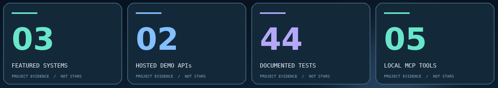

### Engineering the bridge between AI models and real applications.

**Generative AI Engineering** · **Python APIs** · **Agent Workflows**

  
  
  
  

### <code>01 //</code> The engineer behind the systems

I’m **Neeli Yaswanth Kumar**. I work on **Generative AI, Python APIs, retrieval systems and agentic workflows**. My public portfolio focuses on understandable architecture, tested code, and practical backend demonstrations.

**What you'll find here:** carefully scoped MCP developer tooling, tool policy prototypes, model routing infrastructure and evaluation workbenches—each linked to source code, tests and documented limitations.

🌏 **India** · Open to international remote **GenAI / Agentic AI / Python Backend** opportunities.

---

### <code>02 //</code> Featured engineering systems

<table>
<tr>
<td width="33%" valign="top">

**[CodeAtlas MCP](https://github.com/kyaswanthneeli-stack/codeatlas-mcp)**

**Index code once, retrieve targeted structural context.** Reads Python files to build an AST/SQLite snapshot, then serves bounded symbol, call-graph and test-impact candidates through five local MCP tools.

[**Explore visual demo**](https://kyaswanthneeli-stack.github.io/projects/codeatlas-mcp.html) · [**Architecture**](https://github.com/kyaswanthneeli-stack/codeatlas-mcp/blob/main/docs/ARCHITECTURE_AND_BENCHMARK.md)

</td>
<td width="33%" valign="top">

**[AgentGate](https://github.com/kyaswanthneeli-stack/agentgate)**

**Policy checks for agent tool requests.** The hosted FastAPI prototype validates allowlisted tools, redacts selected sensitive patterns and enforces one-use approvals; its two adapters use simulated data.

[**Try live policy inspection**](https://kyaswanthneeli-stack.github.io/projects/agentgate.html) · [**Live Python API**](https://agentgate-production-00036f18.up.railway.app/docs)

</td>
<td width="33%" valign="top">

**[RouteWise](https://github.com/kyaswanthneeli-stack/routewise)**

**Explainable request routing, with conditional fallback.** The hosted FastAPI service uses heuristics to select fast/reasoning routes and can retry configured providers on eligible failures. Its public route-inspection endpoint performs real server-side classification; model responses remain labeled demos until provider credentials are configured.

[**Try live routing**](https://kyaswanthneeli-stack.github.io/projects/routewise.html) · [**Live Python API**](https://routewise-production-c8aefb65.up.railway.app/docs)

</td>
</tr>
</table>

### <code>03 //</code> Engineering evidence, not vanity metrics

Documented implementation scope and CI checks—not GitHub popularity, real LLM savings or paid-provider activity.

### <code>04 //</code> The stack behind the systems

**Backend engineering:** Python, FastAPI, Flask, REST APIs, SQL

**LLMs and retrieval:** RAG, LangGraph, LangChain, MCP, ChromaDB, Milvus

**Delivery and verification:** Docker, Azure, GitHub Actions, Railway

---

### <code>05 //</code> Flagship in progress: RepoPilot

**[RepoPilot — issue-to-patch engineering harness](https://kyaswanthneeli-stack.github.io/ai-engineering-lab/repopilot/)**

An inspectable Python workflow for GitHub issue retrieval, AST code context, LLM patch proposals, Docker verification, offline execution evidence, and approval-gated draft PR publishing.

[**Explore recruiter walkthrough**](https://kyaswanthneeli-stack.github.io/ai-engineering-lab/repopilot/) · [**Read source**](https://github.com/kyaswanthneeli-stack/ai-engineering-lab/tree/main/repopilot) · [**View tested Docker fail-before/pass-after proof**](https://github.com/kyaswanthneeli-stack/ai-engineering-lab/actions/workflows/repopilot.yml)

**Evidence boundary:** The reference patch is genuinely verified in Docker. Live model-generated issue resolution, real draft PR publication and SWE-bench resolution rates have **not** yet been demonstrated. They are not presented as completed capabilities.

---

### <code>06 //</code> The experimentation lab

| Experience | What it shows | Try it |
|:--|:--|:--|
| **[SourceDesk](https://github.com/kyaswanthneeli-stack/sourcedesk)** | BM25 retrieval, document source inspection and evaluation | [Open workbench](https://kyaswanthneeli-stack.github.io/sourcedesk/) |
| **[EvalBench](https://github.com/kyaswanthneeli-stack/ai-engineering-lab)** | Lexical saved-answer regression testing | [Open demo](https://kyaswanthneeli-stack.github.io/ai-engineering-lab/evalbench.html) |
| **[TraceFlow](https://github.com/kyaswanthneeli-stack/ai-engineering-lab)** | Simulated retries, budgets and cancellation | [Open demo](https://kyaswanthneeli-stack.github.io/ai-engineering-lab/traceflow.html) |

<strong>Engineering verification, deployment scope and video walkthroughs</strong>

- **CodeAtlas MCP:** [16 documented tests and tokenizer benchmark](https://github.com/kyaswanthneeli-stack/codeatlas-mcp/actions/workflows/ci.yml) · [architecture walkthrough](https://github.com/kyaswanthneeli-stack/codeatlas-mcp/actions/workflows/walkthrough.yml)
- **AgentGate:** [19 automated tests and Docker CI](https://github.com/kyaswanthneeli-stack/agentgate/actions/workflows/ci.yml) · [public health/authentication smoke checks](https://github.com/kyaswanthneeli-stack/agentgate/actions/workflows/deployment-smoke.yml)
- **RouteWise:** [18 automated tests and Docker CI](https://github.com/kyaswanthneeli-stack/routewise/actions/workflows/ci.yml) · [public health/authentication smoke checks](https://github.com/kyaswanthneeli-stack/routewise/actions/workflows/deployment-smoke.yml)

**Implementation boundaries:** CodeAtlas uses a fixed browser graph fixture; AgentGate and RouteWise browser explorers use live Python FastAPI endpoints. AgentGate uses fixed demo adapters and sends no real notifications. RouteWise has a publicly deployed authenticated API, but no upstream model provider is configured. CodeAtlas's static call graph cannot resolve every dynamic call, and its tokenizer payload measurements do not prove coding-agent cost savings. Walkthrough videos explain architecture rather than capture live model use.

---

### Let's build something worth shipping.

Interested in **Generative AI Engineer**, **Agentic AI Engineer**, and **Python Backend Engineer** opportunities.

[**Portfolio**](https://kyaswanthneeli-stack.github.io/) &nbsp; · &nbsp; [**LinkedIn**](https://www.linkedin.com/in/yaswanthneeli-kumar-134a74414/) &nbsp; · &nbsp; [**Email**](mailto:kyaswanthneeli@gmail.com)

Floating graphics are real looping GIF animations, built with [the open-source graphics script](scripts/build_floating_v2.py) and [GitHub Actions](https://github.com/kyaswanthneeli-stack/kyaswanthneeli-stack/actions/workflows/floating-v2.yml). GitHub controls the avatar and surrounding sidebar.

